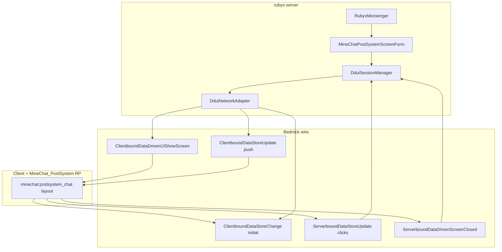

# MineChat: custom DDUI screen for PostSystem (full design)

**Status:** RP screen layout shipped (beta); server domain push + `layout_bridge: false` default  
**Target client:** Bedrock **1.26.60**  
**Server:** rubyx-server PocketMine fork  
**Visual source of truth:** `resource_packs/MineChat_PostSystem/ui/server_form_post.json`  
**Logic reference:** `plugins/RubyxMessenger` (`PostSystemFormBuilder`, `PostSystemChatActions`)

---

## 1. Goals

| ID | Goal |
|----|------|
| G1 | Preserve **MINECHAT** layout (2 columns, textures, avatars, emoji bar, send) — parity with `server_form_post.json`. |
| G2 | **Live updates** via `ClientboundDataStorePacket` while the screen stays open (history, contacts, draft, unread). |
| G3 | **No ModalFormRequest** on routine updates (contact switch, incoming message, poll). |
| G4 | Rubyx plugin API similar to today’s `DduiForm` + `DduiSessionManager`, plus a **declared screen contract**. |
| G5 | Graceful **fallback** to `ui_mode: postsystem` (JSON + existing RP router) when client/pack lacks the screen. |

## 2. Non-goals (MVP)

- Behavior pack / Script API parity with original PostSystem friend requests.
- Per-slot `styleId` beyond root theme (later).
- Replacing JSON UI server-wide; only MineChat chat surface.

---

## 3. Why today’s stack cannot do G1+G2 together

```text
ModalForm (JSON)  →  third_party_server_screen  →  server_form_post
                     bindings: #custom_form collection

DDUI ShowScreen   →  minecraft:custom_form (Ore HTML column)
                     OR custom screenId (RP must define layout + binds)
```

JSON and DDUI **do not share** `#custom_form`. Pushing `custom_form_data` while a Modal form is open does **not** update PostSystem JSON UI (verified: ddui_rp mirror rolled back).

**Conclusion:** one **custom `screenId`** from the resource pack, with layout bound to a **dedicated data-store tree**, server pushes that tree.

---

## 4. Architecture (target)



---

## 5. Screen identity

| Field | Value | Notes |
|-------|--------|------|
| `screenId` | `minechat:postsystem_chat` | Non-`minecraft` namespace (third-party screen). |
| Data-store namespace | `minechat` | From `DduiProperties::dataStoreName($screenId)`. |
| Root property (server) | `postsystem_chat_data` | Per `DduiForm::getRootPropertyName()`. |
| Client property | `postsystem_chat_data_{formId}` | Protocol ≥ 1.26.20 (`DduiProperties::clientPropertyName`). |
| `dataInstanceId` | `formId` | Same as vanilla DDUI custom form. |
| RP pack | `MineChat_PostSystem` | Must register screen definition (format TBD — **Phase 0 spike**). |

Register in [`DDUI_WIRE_CONTRACT.md`](DDUI_WIRE_CONTRACT.md) when implemented.

---

## 6. Data model (canonical — domain-shaped)

Design principle: **stop encoding UX in fake toggles** (`[ER] `, `[E0] `, tooltip-as-chat). The RP reads explicit fields.

### 6.1 Root object

```text
postsystem_chat_data_{formId}: {
  "styleId": string,                    // optional: minechat:postsystem (ddui/styling)
  "chrome": {
    "brandTitle": string,                 // "MINECHAT" (static in RP; server may override)
    "chatHeader": string,                 // "CHAT | Steve_99"
    "partnerId": string                   // server routing; clientWritable: false
  },
  "contacts": {
    "length": long,
    "0" .. "11": {
      "visible": bool,
      "label": string,                    // name + status (no [N] hack; iconIndex instead)
      "iconIndex": long,                  // 0..9 → RP picks head glyph slot
      "selected": bool,
      "unread": bool,
      "disabled": bool,
      "onSelect": long                     // clientWritable pulse, initial 0
    }
  },
  "history": {
    "body": string,                       // formatted thread (§ codes ok)
    "visible": bool
  },
  "compose": {
    "text": string,                       // clientWritable
    "placeholder": string,
    "maxLength": long                     // 100
  },
  "actions": {
    "send":     { "onClick": long },      // clientWritable pulse
    "refresh":  { "onClick": long },
    "close":    { "onClick": long },      // or use root closeButton like CustomForm
    "emoji": {
      "length": long,                     // 11
      "0" .. "10": { "onClick": long, "visible": bool }
    }
  }
}
```

### 6.2 Mapping from legacy PostSystem JSON (today’s PHP)

| Legacy (`PostSystemFormBuilder`) | New path |
|----------------------------------|----------|
| Title `postsystem\|{name}` | `chrome.chatHeader` = `CHAT \| {name}` (RP draws MINECHAT separately) |
| Contact toggle `label` | `contacts.{i}.label` (+ `iconIndex` = `i % CONTACT_ICON_COUNT`) |
| Contact toggle `tooltip` (history) | `history.body` when `contacts.{i}.selected` |
| Emoji toggles `[En] ` | `actions.emoji.{n}.onClick` |
| Refresh `[ER] ` | `actions.refresh.onClick` |
| `textInput` | `compose.text` |

Server keeps **`PostSystemChatActions`** semantics; only the **adapter** changes (parse `onSelect` / `onClick` paths instead of `ModalFormResponse` array).

### 6.3 Bridge layout (optional Phase 1)

To reuse **unchanged** `server_form_post.json` longer, a compatibility mode may mirror **slot order** into `layout.*` identical to `PostSystemDduiLayout` + tooltips (see `MineChatPostSystemDduiForm`). This is **technical debt**; Phase 2 removes it in favour of §6.1.

Slot order (RubyxMessenger today):

```text
0 .. MAX_CONTACTS-1   contact toggles
MAX .. MAX+10         emoji toggles
MAX+11                refresh toggle
MAX+12                text field
```

---

## 7. Resource pack: porting `server_form_post.json`

### 7.1 Current JSON UI dependencies

- `#custom_form` collection (toggle + input indices).
- `#title_text` with prefix `postsystem|`.
- Radio group `custom_toggle` shared by contacts, emoji, refresh.
- Tooltip on **one** contact row drives chat panel visibility.
- Icon avatars via `[0] `..`[9] ` substring tests on `#custom_text`.

### 7.2 Port strategy

| Step | Work |
|------|------|
| P0 | Confirm **how** custom DDUI screens ship in RP (folder, manifest flag, binding API to data-store paths). Spike: minimal `minechat:hello` screen + `ShowScreen` from test command. |
| P1 | Copy visual tree (`post_screen`, `contacts_stack`, `chat_stack`, `input_panel`, textures) into **DDUI screen definition**; replace collection bindings with **observable paths** from §6.1 (e.g. bind label to `contacts.#index.label` — exact binding syntax from spike). |
| P2 | Replace submit-on-toggle with **button `onClick`** pulses (contacts, send, emoji, refresh). Eliminate `button.submit_custom_form` round-trip. |
| P3 | Keep `ddui/styling/minechat_postsystem.json` for Ore-adjacent chrome or drop if fully custom HTML-like surface. |

### 7.3 Assets (unchanged)

- `textures/post_ui/*`, `font/glyph_E1.png`, emoji private-use glyphs `E160`..`E16A`.
- Window size reference: **320×190** (`post_screen` in JSON UI).

### 7.4 `_ui_defs.json`

Today only lists `server_form_post.json` for **Modal** router. Custom DDUI screen likely uses a **different manifest path** (not `ui_defs`). Document outcome of P0 in this file’s changelog.

---

## 8. Server: Rubyx core changes

### 8.1 New API surface (proposed)

```php
// src/form/ddui/DduiScreens.php
public const MINECHAT_POSTSYSTEM = 'minechat:postsystem_chat';

// src/form/ddui/DduiForm.php — unchanged contract

// New: src/form/ddui/MineChatPostSystemScreenData.php
//   buildInitial(Player, state): DynamicValue
//   pushDelta(DduiSession, state, DirtyMask): list<DataStoreUpdate>

// Player:
$player->sendDduiForm($form);  // screenId != minecraft:custom_form
$player->pushDduiClientUpdates($updates);
```

### 8.2 `DduiSessionManager`

Already supports arbitrary `screenId` in `ShowScreen`. No change unless custom screens need different close/reload packets — verify in P0.

### 8.3 Path handling

Extend `DduiPathParser` (or `MineChatPathParser` in plugin):

| Serverbound suffix | Action |
|--------------------|--------|
| `contacts.{i}.onSelect` | `selectedId = contacts[i].id`, mark read, push UI |
| `compose.text` | update draft (no send) |
| `actions.send.onClick` | `PostSystemChatActions::apply` send branch |
| `actions.emoji.{n}.onClick` | send emoji n |
| `actions.refresh.onClick` | reload contacts + push |
| `closeButton.onClick` / `actions.close.onClick` | close session |

### 8.4 Plugin: new session class

Replace dual `PostSystemChatSession` + `MineChatDduiSession` when `ui_mode: postsystem_ddui` (name TBD):

```text
MineChatPostSystemDduiScreenSession
  open() → sendDduiForm(MineChatPostSystemScreenForm)
  onNewMessage() → push only (no sendForm)
  poll() → syncIfDirty → push only
  handleClientUpdate() → PostSystemChatActions equivalent
```

Keep `PostSystemChatSession` as **fallback** for old clients / failed show.

---

## 9. Packet lifecycle

### 9.1 Open

1. `DataStoreChange` — full §6.1 tree (or bridge `layout`).
2. `ShowScreen` — `screenId = minechat:postsystem_chat`, `formId`, `dataInstanceId = formId`.
3. Optional `onDduiOpen` hook (populate MySQL, first push).

### 9.2 Live update (no close)

```text
DataStoreUpdate[] e.g.
  history.body
  contacts.3.unread
  contacts.2.selected
  chrome.chatHeader
  compose.text   (server clearing draft after send)
```

Rate limits: existing `DduiSettings` inbound/outbound per tick.

### 9.3 Close

1. `ClientboundDataDrivenUICloseScreenPacket(formId)`.
2. Clear owned session data (manager today).
3. `MineChatPostSystemDduiScreenSession::close` — cancel poll tasks.

---

## 10. Dirty mask / push optimization

```text
DirtyMask:
  CONTACTS_META   // labels, unread, visible count
  SELECTION       // selected row + chatHeader
  HISTORY         // history.body
  COMPOSE         // compose.text
  FULL            // initial open / error recovery
```

`onNewMessage` → `HISTORY` (+ maybe `CONTACTS_META` for unread).  
Contact tap → `SELECTION` + `HISTORY` + `CONTACTS_META`.  
Send message → `HISTORY` + `COMPOSE` (+ `CONTACTS_META`).

Avoid full tree replace after open.

---

## 11. Feature detection & config

```yaml
# plugins/RubyxMessenger/resources/config.yml
ui_mode: postsystem_ddui   # new: custom screen when supported
ui_mode_fallback: postsystem

minechat_screen:
  screen_id: minechat:postsystem_chat
  style_id: minechat:postsystem   # ddui/styling optional
  min_protocol: 766               # 1.26.20+ instance suffix
```

```php
// Detection order
if (ui_mode is postsystem_ddui && player.supportsDdui() && pack_has_screen)
    MineChatPostSystemDduiScreenSession::open();
else
    PostSystemChatSession::open();
```

Pack detection: reuse `DduiThemeScanner` pattern — scan RP for screen registration file (TBD path from P0).

---

## 12. Implementation phases

| Phase | Deliverable | Exit criterion |
|-------|-------------|----------------|
| **0 — Spike** | Doc update with RP file format; `/ddui` dev command opens `minechat:hello` | Client shows non-empty custom screen from server |
| **1 — Static screen** | RP port `post_screen` with **hardcoded** sample data bindings | Visual match screenshot (no wiring) |
| **2 — Wire MVP** | Server push `history.body` + `contacts.0.label`; one `onSelect` | Tap contact updates header + history without reshow |
| **3 — Parity** | Send, emoji, refresh, close, draft, MySQL | Feature parity with `PostSystemChatSession` |
| **4 — Product** | `ui_mode: postsystem_ddui` default for 1.26.60+; docs + tests | Manual smoke on 19135 |
| **5 — Hardening** | PHPUnit on `MineChatPostSystemScreenData` cereal tree; rate limits; timeout | CI green |

Estimated effort (rough): **P0–1:** 3–5 d (depends on undisclosed RP DDUI screen format); **P2–3:** 5–8 d server+plugin; **P4–5:** 2–3 d.

---

## 13. Testing

| Test | Method |
|------|--------|
| Visual regression | Screenshot: legacy `postsystem` vs `postsystem_ddui` (same contacts/messages) |
| Push latency | Incoming `/tell` with UI open — no `ModalFormRequest` in packet log |
| Contact switch | 12 contacts rapid tap — no session leak; correct `partnerId` |
| Fallback | Remove RP screen → opens JSON postsystem |
| Protocol | 1.26.19 vs 1.26.60 property suffix |

Packet capture: log `ShowScreen.screenId`, `DataStore` paths on join test.

---

## 14. Risks

| Risk | Mitigation |
|------|------------|
| **RP format for custom DDUI unknown** | Phase 0 mandatory; ask Mojang docs / reverse LeviLamina / packet sniff BDS |
| JSON UI deprecation | Custom DDUI screen is forward-looking; still need Ore/HTML binding docs |
| `styleId` + custom layout interaction | May be separate; theme only on embedded Ore controls |
| Beta APIs for third-party styles | Document requirement; dev worlds with experiments |
| Anti-cheat / client ignores `onClick` | Same trust model as vanilla DDUI; validate on server |

---

## 15. References (repo)

| Asset | Path |
|-------|------|
| PostSystem RP | `resource_packs/MineChat_PostSystem/ui/server_form_post.json` |
| Modal router | `resource_packs/MineChat_PostSystem/ui/server_form.json` |
| DDUI styling | `resource_packs/MineChat_PostSystem/ddui/styling/minechat_postsystem.json` |
| PHP builder | `plugins/RubyxMessenger/.../PostSystemFormBuilder.php` |
| Actions | `plugins/RubyxMessenger/.../PostSystemChatActions.php` |
| Live layout slots | `plugins/RubyxMessenger/.../PostSystemDduiLayout.php` |
| Wire doc | `docs/DDUI_WIRE_CONTRACT.md` |
| Theming limits | `docs/DDUI_THEMING.md` |

---

## 16. Next action (recommended)

1. **Phase 0 ticket:** minimal `minechat:postsystem_chat` in RP + rubyx `/ddui postsystem-spike` with static §6.1 payload.  
2. Record **exact binding names** the client exposes in screen JSON.  
3. Only then start rewriting `server_form_post` factories to bind `contacts.*` instead of `#custom_form`.

## 17. RP screen file format (implemented)

| Item | Value |
|------|--------|
| Path | `resource_packs/MineChat_PostSystem/ddui/screens/minechat/postsystem_chat.json` |
| Identifier | `minechat:postsystem_chat` (LeviLamina convention: `ddui/screens/<namespace>/<name>.json`) |
| Format | `format_version: beta`, `minecraft:data_driven_ui_screen` |
| Data | Data store `minechat`, root `postsystem_chat_data` (§6.1) |
| Discovery | `DduiScreenScanner` on boot + `/resourcepacks reload` |

Reload on client (OP): `/reload ddui` after pack update.

If layout is blank or generic Ore column, client may not fully support experimental layout keys — capture wire + adjust bindings with `/ddui` → **minechat:postsystem_chat (RP spike)**.

Link: `DDUI_IMPLEMENTATION_STATUS.md`, `DDUI_WIRE_CONTRACT.md`.
